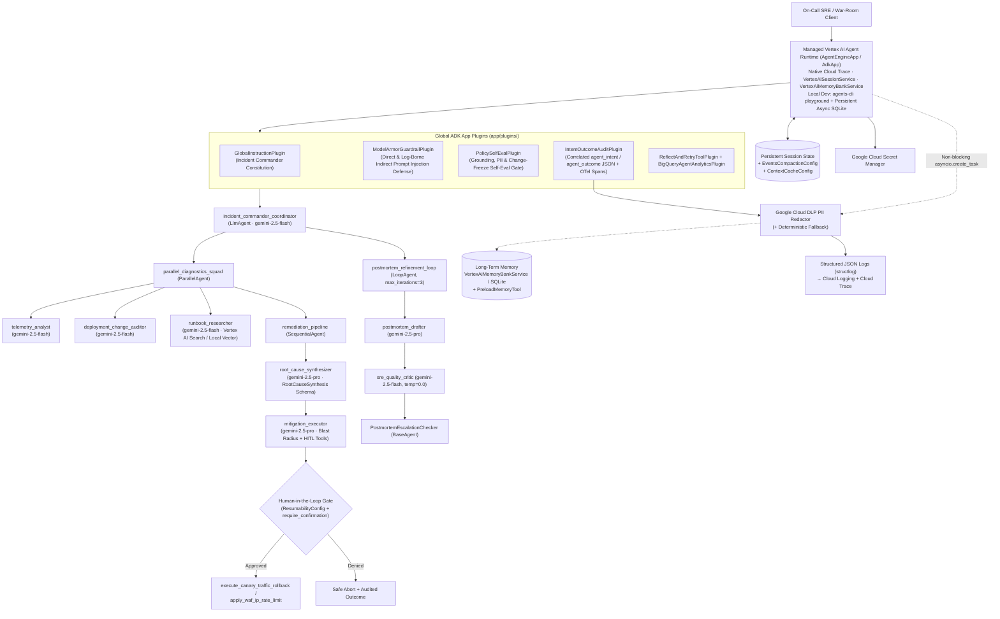

# AegisOps (`aegis-ops-agent`)

**Autonomous Cloud Incident Triage, Runbook Grounding & Guarded Remediation Agent** built with **Google Agent Development Kit (ADK 2.x)**, scaffolded with **`agents-cli`**, and engineered for **Managed Vertex AI Agent Runtime (`agent_runtime`)**.

> **Track:** Enterprise Agents (Cloud Operations / SRE)
> **Key Design Principle:** Production SRE automation must be fast for read-only diagnostics, strictly grounded in telemetry and verified runbooks, defended against log-borne prompt injection and PII leaks, and **always gated behind Human-in-the-Loop (HITL) approval** before mutating live infrastructure.

---

## Architecture



---

## AgentOps Rubric Evidence Matrix (19 / 19 Criteria · 95 / 95 Points)

| Category | Criterion | Implementation Evidence (Exact Files & Symbols) |
| :--- | :--- | :--- |
| **1. Tool & Interface Design** | **Comprehensive Tool Docstrings** | All 9 tools in [`app/tools/diagnostics_tools.py`](app/tools/diagnostics_tools.py), [`app/tools/remediation_tools.py`](app/tools/remediation_tools.py), and [`app/tools/memory_tools.py`](app/tools/memory_tools.py) provide complete Google-style docstrings covering purpose, every parameter + constraints, return schema, and recovery codes. |
| | **Descriptive Naming** | Hyper-specific verb-noun SRE names: `fetch_service_telemetry_anomalies`, `correlate_recent_deployments`, `search_verified_runbooks`, `list_verified_healthy_revisions`, `calculate_blast_radius_estimate`, `execute_canary_traffic_rollback`, `apply_waf_ip_rate_limit`, `send_war_room_incident_update`, `recall_historical_incident_lessons`. |
| | **Explicit JSON Schemas** | Strict Pydantic v2 input/output contracts with regex/CIDR/numeric bounds and `export_all_tool_schemas()` in [`app/schemas/incidents.py`](app/schemas/incidents.py), plus agent-level `output_schema` (`RootCauseSynthesis`, `PostmortemCritique`). |
| | **Guided Error Handling** | Unified [`ToolErrorEnvelope`](app/schemas/incidents.py) returning `error_code`, `recovery_instructions`, `suggested_next_tool`, and `valid_options` (e.g., `UNHEALTHY_TARGET_REVISION` guides the LLM to call `list_verified_healthy_revisions` instead of crashing). |
| **2. Context & Memory** | **Robust System Instructions** | Versioned 6-section Incident Commander Constitution in [`app/prompts/constitution.py`](app/prompts/constitution.py), enforced globally via `GlobalInstructionPlugin` in [`app/agent.py`](app/agent.py). |
| | **History Compaction** | [`app/agent.py`](app/agent.py) wires both ADK `EventsCompactionConfig(compaction_interval=10, overlap_size=3, token_threshold=12000, event_retention_size=6, summarizer=LlmEventSummarizer(...))` and `ContextCacheConfig(min_tokens=2048, ttl_seconds=1800, cache_intervals=10)`. |
| | **Persistent Session State** | [`app/memory/session_factory.py`](app/memory/session_factory.py) connects to `VertexAiSessionService` in Managed Agent Runtime and persistent async SQLite `DatabaseSessionService` locally; [`search_verified_runbooks`](app/tools/diagnostics_tools.py) integrates **Vertex AI Search** (`google-cloud-discoveryengine`) with deterministic local vector fallback. |
| | **Async Memory Operations** | [`app/memory/async_memory.py`](app/memory/async_memory.py) registers `schedule_async_memory_consolidation` as `after_agent_callback`, spawning non-blocking `asyncio.create_task` background jobs that scrub PII via Cloud DLP before persisting lessons to `VertexAiMemoryBankService` / persistent SQLite store (recalled via `PreloadMemoryTool` + `recall_historical_incident_lessons`). |
| **3. Orchestration & Logic** | **Multi-Agent Patterns** | 4 ADK patterns across [`app/agents/`](app/agents/): Coordinator (`LlmAgent`), `ParallelAgent` (`parallel_diagnostics_squad`), `SequentialAgent` (`remediation_pipeline`), and `LoopAgent` (`postmortem_refinement_loop` with custom `PostmortemEscalationChecker(BaseAgent)`). |
| | **Strategic Model Routing** | [`app/config/models.py`](app/config/models.py) (`ModelRouterConfig`) intentionally routes fast triage/parallel extraction/compaction to `gemini-2.5-flash`, complex causal synthesis/mitigation/postmortem drafting to `gemini-2.5-pro`, and self-eval critique to `gemini-2.5-flash` at `temperature=0.0`. |
| | **Guardrails & Policy Plugins** | [`app/plugins/guardrails_plugin.py`](app/plugins/guardrails_plugin.py) + [`app/security/model_armor.py`](app/security/model_armor.py): `ModelArmorGuardrailPlugin` (Google Cloud Model Armor screening user prompts, tool outputs against poisoned crash logs, and responses), `PolicySelfEvalPlugin` (groundedness & change-freeze self-eval), and `ReflectAndRetryToolPlugin`. |
| | **Human-in-the-Loop Hooks** | `ResumabilityConfig(is_resumable=True)` in [`app/agent.py`](app/agent.py) + conditional `FunctionTool(execute_canary_traffic_rollback, require_confirmation=requires_production_rollback_approval)` + unconditional `FunctionTool(apply_waf_ip_rate_limit, require_confirmation=True)` + explicit `tool_context.request_confirmation(...)` in [`app/tools/remediation_tools.py`](app/tools/remediation_tools.py). |
| **4. Observability & Tracing** | **Structured JSON Logging** | [`app/observability/logging_setup.py`](app/observability/logging_setup.py) configures `structlog` JSON output formatted for Google Cloud Logging with trace correlation and mandatory PII redaction (verified zero `print()` statements in `app/`). |
| | **Intent vs. Outcome Capture** | [`app/plugins/audit_observability_plugin.py`](app/plugins/audit_observability_plugin.py) (`IntentOutcomeAuditPlugin`) logs correlated UUID `action_id` pairs: `event_type="agent_intent"` in `before_tool_callback` and `event_type="agent_outcome"` in `after_tool_callback` / `on_tool_error_callback` with `intent_matched_outcome` and `duration_ms`. |
| | **Distributed Tracing** | [`app/observability/tracing.py`](app/observability/tracing.py) + [`app/agent_runtime_app.py`](app/agent_runtime_app.py) (`enable_tracing=True`, `setup_telemetry()`, OpenTelemetry `TracerProvider` + `CloudTraceSpanExporter`, W3C trace context injected into structured JSON logs). |
| | **PII Redaction** | [`app/security/pii_redactor.py`](app/security/pii_redactor.py) integrates **Google Cloud DLP** (`DlpServiceClient.deidentify_content`) + deterministic Luhn/token/PII scrubber enforced automatically in **both** `structlog` and async memory / tool pipelines. |
| **5. Infrastructure & CI/CD** | **Automated Evaluation Suites** | [`tests/eval/eval_config.yaml`](tests/eval/eval_config.yaml) + golden datasets in [`tests/eval/datasets/`](tests/eval/datasets/) graded via `agents-cli eval run` (`multi_turn_task_success`, `multi_turn_tool_use_quality`, `hallucination`, `safety`, + 3 deterministic `CodeExecutionMetric`s), alongside `pytest` unit/integration suites in [`.github/workflows/pr_checks.yaml`](.github/workflows/pr_checks.yaml). |
| | **Infrastructure as Code** | Scaffolded via **`agents-cli`** ([`agents-cli-manifest.yaml`](agents-cli-manifest.yaml)) with complete Terraform under [`deployment/terraform/single-project/`](deployment/terraform/single-project/) and [`deployment/terraform/cicd/`](deployment/terraform/cicd/) provisioning `google_vertex_ai_reasoning_engine` (`min_instances = 0` idle-free), Secret Manager secrets, DLP/Model Armor/Vertex Search IAM, BigQuery telemetry, and WIF CI/CD. |
| | **Secure Secret Management** | [`app/config/secrets.py`](app/config/secrets.py) (`SecretManagerProvider` backed by `google-cloud-secret-manager`) + Terraform secret shells + least-privilege `secretAccessor` bindings + fail-closed prod mode + [`.env.example`](.env.example) (zero hardcoded keys). |

---

## Quickstart

### 1. Install Dependencies
```bash
uv sync --all-extras
cp .env.example .env
```

### 2. Run Automated Unit & Offline Integration Tests
```bash
AEGIS_ENV=test AEGIS_OFFLINE_MODE=true uv run pytest tests/unit tests/integration/test_persistence_and_hitl.py -v
```

### 3. Run Linting & Type Checks
```bash
uv run ruff check app tests
uv run ty check app
uv run codespell app tests README.md
```

### 4. Run Golden Evaluation Suite (Vertex AI Eval Service)
```bash
export GOOGLE_CLOUD_PROJECT="sandaw-project-2121"
export GOOGLE_CLOUD_LOCATION="us-central1"
agents-cli eval run
```

### 5. Interactive Local Playground (Live Demo)
```bash
agents-cli playground
```

Try these built-in synthetic NovaShop Cloud incident prompts:
1. **P1 Outage + Leaked PII + HITL Rollback**: `"Triage P1 incident INC-2026-1042 on checkout-api, synthesize root cause, check blast radius, and initiate the runbook-recommended canary rollback."`
2. **Guided Error Recovery**: `"Roll back checkout-api to revision checkout-api-v2.3.9 for INC-2026-1042."` *(Returns `UNHEALTHY_TARGET_REVISION`, prompting automatic self-recovery via `list_verified_healthy_revisions`.)*
3. **Poisoned-Log Prompt Injection Defense**: `"Investigate INC-2026-1043 on auth-gateway where login latency spiked, and propose safe edge mitigation."` *(Neutralizes embedded prompt-injection payload in crash logs via Model Armor guardrail and proposes HITL-gated WAF rate limiting on `198.51.100.42/32`.)*
4. **Blameless Postmortem Loop**: `"Now draft a blameless SRE postmortem for INC-2026-1042."`

### 6. Provision Infrastructure & Deploy to Managed Agent Runtime
```bash
# Optional: provision single-project IAM, Secret Manager shells, telemetry & Agent Runtime via Terraform
agents-cli infra single-project --project sandaw-project-2121

# Deploy agent source directly to Managed Vertex AI Agent Runtime
agents-cli deploy --project sandaw-project-2121 --region us-central1
```
